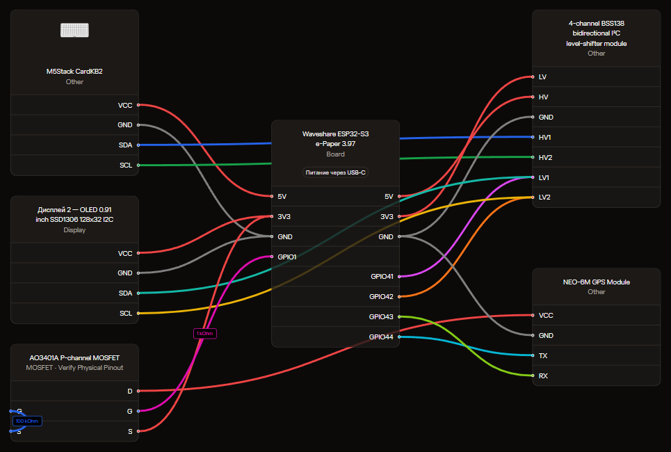

# ◈ PocketOS

### A pocket-sized E-Ink computer powered by ESP32-S3

**An experimental embedded OS for the Waveshare ESP32-S3 E-Ink platform.**

**[Web Flasher / Прошивка из браузера](https://1filth1.github.io/pocketos/) · [English](#pocketos-v01--english) · [Русский](#pocketos-v01--русский) · [Release notes](RELEASE_NOTES_v0.1.2-rc.5.md) · [Project status](docs/PROJECT_STATUS.md) · [Roadmap](docs/ROADMAP.md) · [Security](SECURITY.md) · [Architecture](docs/ARCHITECTURE.md) · [Hardware](docs/HARDWARE.md) · [Testing](docs/TESTING.md) · [Release process](docs/RELEASE_PROCESS.md) · [Firmware archive audit](docs/FIRMWARE_ARCHIVE_AUDIT.md) · [Build guide](docs/BUILD.md) · [3D printing / 3D-печать](docs/3D_PRINTING.md) · [License](LICENSE)**

---

> [!IMPORTANT]
> PocketOS is an early-stage project. Features and hardware integrations are still being validated. Do not treat this development build as a stable release or flash it without understanding the risks.

## ⚡ Install PocketOS from your browser

Use the **[PocketOS Web Flasher](https://1filth1.github.io/pocketos/)** to install the firmware directly from a supported desktop browser—no separate flashing utility is required. Connect the ESP32-S3 board with a USB data cable, open the flasher in the latest Chrome or Edge, select the device's serial port, and follow the on-screen steps.

The flasher loads the firmware package and flash addresses from the published build manifest and verifies each downloaded file with SHA-256 before writing. Use only a package that matches your exact board configuration. **Important:** flashing writes the bootloader, partition table and application; changing the partition layout can erase data stored in Flash. Back up the SD card and important internal Flash data first. The candidate uses the app3M_fat9M_16MB layout; data from the older SPIFFS layout may become inaccessible. Keep USB and power connected until flashing has fully completed. The browser flasher requires Web Serial and HTTPS; it is not supported by Firefox or Safari.

## ✦ What is PocketOS?

PocketOS turns an ESP32-S3 E-Ink device into a compact standalone computer. It combines a graphical interface, built-in tools, SD-card storage, connectivity and multimedia features in one firmware project.

The interface targets an **800 × 480 E-Ink display** and is navigated with a connected keyboard.

## ◈ At a glance

| Area | What is included |
|---|---|
| **System UI** | Home screen, application launcher, settings and system screens |
| **Files & notes** | SD-card file manager, text notes and document reading |
| **Productivity** | Calendar, timer, RTC clock and quick settings |
| **Media** | Audio player/tools, voice recorder, image and video viewers |
| **Connectivity** | Wi-Fi, web reader and file exchange |
| **Navigation** | GPS features when a compatible module is connected |
| **Entertainment** | Built-in games and interactive applications |
| **Device status** | Battery, charging, temperature, humidity, Wi-Fi and SD-card status |

Availability depends on the connected hardware and the current state of development. A feature in the source tree is not automatically a verified hardware feature.

## ▣ Hardware platform

| Component | Target |
|---|---|
| Main controller | Waveshare ESP32-S3 |
| Main display | 800 × 480 E-Ink |
| E-Ink controller | GDEM0397T81 |
| Storage | SD card via SD_MMC |
| Input | CardKB2 keyboard over I²C |
| Clock | I²C RTC |
| Environment sensor | SHTC3 |
| Power management | AXP2101 |
| Wireless | ESP32-S3 Wi-Fi |
| Optional expansion | GPS and other compatible peripherals |

### Connection diagram

The diagram is provided in the repository documentation. Confirm the exact board revision and wiring against the physical device before making changes.

> Pin mapping, board revision, Flash/PSRAM configuration, partition layout and library versions must be confirmed against the actual Schematic.io project and hardware revision before producing release firmware.

## 🧩 3D printing / 3D-печать

Printable STL files for the PocketOS enclosure and controls are listed in **[docs/3D_PRINTING.md](docs/3D_PRINTING.md)**. The page provides individual download links and pre-print fit-check guidance.

STL files: `KB.stl`, `backeink.stl`, `button_eink (1).stl`, `front_eink.stl`, `speaker.stl`.

## ◈ Project architecture

PocketOS v0.1 is implemented as a **single firmware image**. Built-in applications are compiled into the project and run in the same address space.

This means PocketOS is not yet a conventional desktop/mobile OS with isolated processes, and it does not currently execute arbitrary application binaries installed from the SD card.

The SD card is intended for user files, application data, resources and saves.

## ▣ Repository map

| Path | Purpose |
|---|---|
| `main.cpp` | Main firmware entry point and system integration |
| `*_app.h` | Built-in application modules |
| `display2.h`, `epaper_ui.h` | Display and UI support |
| `os_core.h` | Core application registry |
| `RELEASE_NOTES_v0.1.1-rc.2.md` | v0.1.1-rc.2 candidate release notes |
| `docs/PROJECT_STATUS.md` | Current development and validation status |
| `docs/ARCHITECTURE.md` | Preliminary system architecture |
| `docs/HARDWARE.md` | Source-derived hardware reference (not a verified wiring guide) |
| `docs/TESTING.md` | Hardware and software test plan |
| `docs/RELEASE_PROCESS.md` | Release and verification process |
| `docs/FIRMWARE_ARCHIVE_AUDIT.md` | Static audit of the supplied firmware ZIP |
| `docs/3D_PRINTING.md` | STL model catalogue and 3D-printing notes |
| `LICENSE` | MIT License |

The source tree is evolving; this map highlights the main entry points rather than every header.

## ◈ Project status

**Current stage: experimental v0.1.1-rc.2 candidate; physical validation on the target board is still pending.**

- [x] Bilingual project overview and release notes
- [x] Pinned Arduino-ESP32 toolchain and library dependencies
- [x] Waveshare N16R8 profile: 16 MB Flash / 8 MB OPI PSRAM, DIO 80 MHz, app3M_fat9M_16MB layout
- [x] GitHub Actions firmware compilation and packaging completed successfully
- [x] Firmware binaries, manifest and SHA-256 checksums published in the prerelease
- [x] Web Flasher deployed to GitHub Pages
- [x] Connection diagram added to the hardware documentation
- [ ] Flash the v0.1.1-rc.2 candidate onto the target device
- [ ] Complete physical validation of E-Ink, side OLED, keyboard/I²C, SD, audio, Wi-Fi and power

**Latest candidate:** [v0.1.1-rc.2](https://github.com/1filth1/pocketos/releases/tag/v0.1.1-rc.2) · [Web Flasher](https://1filth1.github.io/pocketos/) · [Build workflow](https://github.com/1filth1/pocketos/actions/workflows/firmware-build.yml)

See **[Project status & validation checklist](docs/PROJECT_STATUS.md)** for details.

## ▣ Development

The project is currently developed in **Schematic.io** for the Waveshare ESP32-S3 E-Ink target.

The CI build uses a pinned Arduino-ESP32 toolchain and libraries with the Waveshare N16R8 memory profile. The DIO flash mode follows the user's known-good firmware archive and addresses the earlier ROM-stage QIO boot failure; the exact app3M_fat9M_16MB partition table is checked against the generated binary. Hardware behavior still requires testing on the physical board.

For contribution workflow and coding expectations, see [CONTRIBUTING.md](CONTRIBUTING.md). The development priorities are listed in the [roadmap](docs/ROADMAP.md). See the preliminary [architecture overview](docs/ARCHITECTURE.md), [source-derived hardware reference](docs/HARDWARE.md), and [test plan](docs/TESTING.md). Security reports are covered by [SECURITY.md](SECURITY.md). The project is distributed under the [MIT License](LICENSE), subject to the notices and licenses of third-party components.

## ◈ Known limitations

- Built-in applications share one address space.
- Arbitrary executable applications cannot currently be installed and launched from the SD card.
- Some features depend on external modules, Wi-Fi or SD-card availability.
- Memory use, refresh behavior, power consumption and long-term stability require testing on real hardware.
- No stable firmware binary or universal flashing configuration is promised by this development branch.

## ▣ Safety & data

- Back up the SD card before testing experimental firmware.
- Do not assume an update preserves every user file until that behavior has been tested.
- Use firmware and flashing parameters only when they match the exact board revision.
- Report reproducible failures with logs, steps and hardware details.

---

# PocketOS v0.1 — Русский

### Карманный E-Ink-компьютер на базе ESP32-S3

## ⚡ Прошивка PocketOS прямо из браузера

Открой **[PocketOS Web Flasher](https://1filth1.github.io/pocketos/)** — он позволяет установить прошивку прямо из браузера, без отдельной программы для прошивки. Подключи плату ESP32-S3 USB-кабелем с передачей данных, открой страницу в актуальном Chrome или Edge на компьютере, выбери последовательный порт устройства и следуй инструкциям на экране.

Флешер получает файлы прошивки и адреса записи из манифеста опубликованной сборки и проверяет SHA-256 каждого файла перед записью. Используй только комплект, соответствующий твоей аппаратной конфигурации. **Важно:** при прошивке записываются загрузчик, таблица разделов и приложение; изменение разметки Flash может привести к потере данных во Flash-памяти. Заранее сделай резервную копию SD-карты и важных данных во внутренней Flash. Кандидат использует разметку app3M_fat9M_16MB; данные старого раздела SPIFFS могут стать недоступны. Не отключай USB и питание до полного завершения прошивки. Для работы нужны Web Serial и HTTPS; Firefox и Safari не поддерживаются.

**PocketOS** — экспериментальная встроенная операционная система для устройства на базе Waveshare ESP32-S3 с E-Ink-дисплеем 800 × 480. Проект объединяет графический интерфейс, встроенные приложения, хранение пользовательских данных на SD-карте, сетевые и мультимедийные функции.

> [!IMPORTANT]
> PocketOS находится на ранней стадии разработки. Возможности и работа периферии ещё проверяются. Это не стабильная прошивка для повседневного использования. Перед экспериментами сделайте резервную копию SD-карты.

## ✦ Что умеет PocketOS

| Направление | Возможности |
|---|---|
| **Интерфейс** | Главный экран, меню приложений, настройки и системные экраны |
| **Файлы и заметки** | Файловый менеджер SD-карты, текстовые заметки и чтение документов |
| **Органайзер** | Календарь, таймер, часы RTC и быстрые настройки |
| **Мультимедиа** | Аудиоплеер и инструменты, диктофон, просмотр изображений и видео |
| **Связь** | Wi-Fi, веб-просмотр и обмен файлами |
| **Навигация** | GPS-функции при подключении совместимого модуля |
| **Развлечения** | Встроенные игры и интерактивные приложения |
| **Состояние устройства** | Батарея, зарядка, температура, влажность, Wi-Fi и SD-карта |

Наличие модуля в исходниках ещё не означает, что функция полностью проверена на реальном устройстве.

## ▣ Аппаратная платформа

| Компонент | Целевая конфигурация |
|---|---|
| Контроллер | Waveshare ESP32-S3 |
| Основной экран | E-Ink 800 × 480 |
| Контроллер E-Ink | GDEM0397T81 |
| Хранилище | SD-карта через SD_MMC |
| Ввод | Клавиатура CardKB2 по I²C |
| Часы | RTC по I²C |
| Датчик среды | SHTC3 |
| Управление питанием | AXP2101 |
| Беспроводная связь | Wi-Fi ESP32-S3 |
| Дополнительные модули | GPS и другая совместимая периферия |

Распиновку, ревизию платы, параметры Flash/PSRAM, таблицу разделов и версии библиотек необходимо сверить с проектом Schematic.io и конкретным устройством.

## ◈ Как устроена система

PocketOS v0.1 собирается как **единая прошивка**. Встроенные приложения входят в проект и работают в общем адресном пространстве.

Это пока не классическая многозадачная ОС с изоляцией процессов. Произвольные исполняемые приложения с SD-карты сейчас не запускаются.

SD-карта предназначена для пользовательских файлов, данных приложений, ресурсов и сохранений.

## ▣ Состояние проекта

**Текущий этап: экспериментальный кандидат v0.1.1-rc.2; аппаратная проверка на целевой плате ещё не выполнена.**

- [x] Описание проекта и Release Notes на двух языках
- [x] Зафиксированы версии Arduino-ESP32 и библиотек
- [x] Профиль Waveshare N16R8: Flash 16 MB / OPI PSRAM 8 MB, DIO 80 MHz, разметка app3M_fat9M_16MB
- [x] GitHub Actions успешно собрал и упаковал прошивку
- [x] Бинарники, manifest.json и SHA-256 опубликованы в prerelease
- [x] Web Flasher опубликован на GitHub Pages
- [x] Схема подключения добавлена в документацию
- [ ] Прошить кандидат v0.1.1-rc.2 на целевое устройство
- [ ] Завершить проверку E-Ink, бокового OLED, клавиатуры/I²C, SD, аудио, Wi-Fi и питания

**Последний кандидат:** [v0.1.1-rc.2](https://github.com/1filth1/pocketos/releases/tag/v0.1.1-rc.2) · [Web Flasher](https://1filth1.github.io/pocketos/) · [Сборка GitHub Actions](https://github.com/1filth1/pocketos/actions/workflows/firmware-build.yml)

Подробности: **[статус проекта и чек-лист проверки](docs/PROJECT_STATUS.md)**.

## ▣ Разработка

Проект разрабатывается в **Schematic.io** под Waveshare ESP32-S3 E-Ink.

CI использует зафиксированные версии Arduino-ESP32 и библиотек, профиль памяти Waveshare N16R8 и проверяет бинарную таблицу app3M_fat9M_16MB. Режим Flash DIO выбран по пользовательскому рабочему архиву и устраняет выявленное несоответствие QIO на ранней стадии ROM-загрузки. Физическую работу периферии всё равно необходимо проверить на самой плате.

Правила работы с проектом описаны в [CONTRIBUTING.md](CONTRIBUTING.md). Приоритеты дальнейшей разработки собраны в [дорожной карте](docs/ROADMAP.md). Предварительное описание архитектуры — в [ARCHITECTURE.md](docs/ARCHITECTURE.md), аппаратные заметки — в [HARDWARE.md](docs/HARDWARE.md), план проверок — в [TESTING.md](docs/TESTING.md). Порядок сообщения об уязвимостях — в [SECURITY.md](SECURITY.md). Проект распространяется по [лицензии MIT](LICENSE) с учётом лицензий и уведомлений сторонних компонентов.

## ◈ Ограничения и безопасность

- Встроенные приложения используют общее адресное пространство.
- Установка и запуск произвольных исполняемых приложений с SD-карты пока не реализованы.
- Часть функций зависит от внешних модулей, Wi-Fi или наличия SD-карты.
- Память, обновление E-Ink, энергопотребление и стабильность требуют испытаний на реальном устройстве.
- В этой ветке пока не гарантируются стабильный бинарник и универсальные параметры прошивки.

Перед тестированием сделайте резервную копию SD-карты. Используйте только те параметры прошивки, которые соответствуют вашей аппаратной ревизии.

---

**PocketOS · Built for the E-Ink form factor**

*Small device. Big possibilities.*

